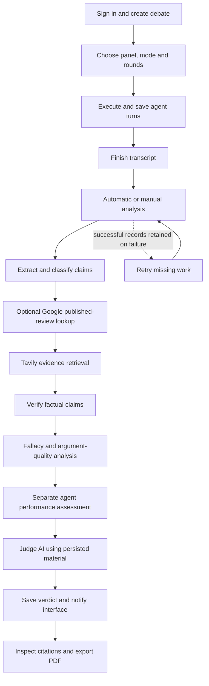
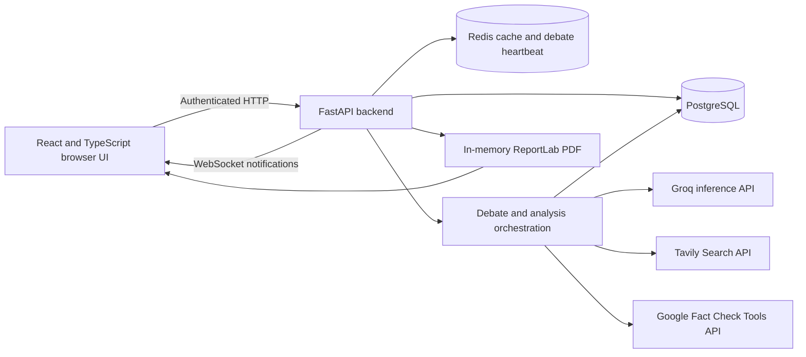

# MAVES — AI Debate Arena

**Multi-Agent LLM System for Structured Debate, Evidence Analysis, and Argument Verification.**

MAVES brings specialist AI agents into a multi-round debate, extracts their claims, retrieves external evidence, and presents a reasoned assessment with citations and limitations. It helps readers inspect arguments and compare perspectives instead of treating one generated answer as established fact.

Developed as a final-year B.Tech CSE (Data Science) project for academic year 2026–27. Generated arguments, analyses, and verdicts can be wrong; MAVES does not guarantee factual correctness.

[Overview](#project-overview) · [Workflow](#how-maves-works) · [Installation](#local-installation) · [Environment](#environment-variables) · [API](#api-documentation) · [Testing](#testing) · [Deployment audit](PRE_DEPLOYMENT_AUDIT.md)

## Project overview

A debate question can contain facts, assumptions, opinions, and value judgments. MAVES organizes the discussion into specialist agent turns and stores the material needed to inspect those distinctions. Readers can follow execution, inspect individual claims and sources, compare reasoning quality, and export the saved results.

This is an academic prototype with tested core workflows. Public hosting requires the controls described in [PRE_DEPLOYMENT_AUDIT.md](PRE_DEPLOYMENT_AUDIT.md). The development Compose stack is not a public deployment configuration.

## Key features

- **Specialist panels:** manual selection of built-in agents, topic-aware recommendations, and optional debate-specific AI specialist roles.
- **Multi-round debates:** balanced and pro/con modes, structured arguments and rebuttal references, saved transcripts, and failed-turn resume.
- **Live progress:** saved turn counts, round timeline, active agent, timestamped activity, reconnect recovery, and a separate analysis timeline.
- **Claim analysis:** resumable structured extraction, factual/opinion/prediction classification, message references, and conservative duplicate grouping.
- **Evidence:** Tavily web retrieval and optional Google Fact Check published reviews, preserving original publisher ratings, attribution, URLs, and available dates.
- **Verification:** Supported, Contradicted, Partially Supported, Insufficient Evidence, and Not Verified states. Provider failures remain separate from findings.
- **Argument analysis:** individual and batch fallacy checks, explicit no-fallacy results, versioned argument-quality scores, strengths, weaknesses, and comparisons.
- **Separate assessments:** agent performance rankings and a final debate verdict with confidence, reasoning, assumptions, citations, and limitations.
- **Accounts and reports:** user-owned debate history, registration/login, protected pages, analytics, and PDFs built from saved records.

Google lookup is optional. Missing credentials or no matching review do not make a claim false. Semantic duplicate detection is conservative. Background jobs run inside the backend process, rather than a durable distributed queue.

## How MAVES works

1. Sign in and create a debate question with optional context.
2. Choose a panel, debate mode, round count, and evidence-verification preference.
3. Start execution. Agents contribute saved arguments across the configured rounds.
4. Follow actual saved progress and inspect completed rounds.
5. After the transcript finishes, automatic analysis starts when both automatic analysis and debate evidence verification are enabled. Otherwise start it from Final Verdict or an analysis tab.
6. Extract and classify claims from eligible participant messages, retaining their original message references.
7. Search published fact-checks where configured, retrieve Tavily sources, and verify factual claims against stored evidence.
8. Analyze eligible messages for fallacies and argument quality, then evaluate agent performance separately.
9. Judge AI generates and saves an assessment using the transcript and persisted analysis. Missing evidence can force INCONCLUSIVE.
10. Review results, retry missing work or regenerate a verdict, and download a PDF.



Overall execution follows `CREATED → STARTING → RUNNING → ANALYZING → GENERATING_VERDICT → COMPLETED`, with failure/cancellation states represented where applicable. The legacy API `status` tracks the transcript; `execution_state` and the execution snapshot describe the overall workflow. A finished transcript is not a finished analysis. There is no general user-facing cancel control yet.

## System architecture



PostgreSQL is the source of truth for transcripts, claims, evidence, analyses, verdicts, stage progress, and execution events. Redis supports recommendation caching and debate liveness. Analysis uses an atomic database claim, renewable heartbeat, and run ID to prevent superseded jobs from overwriting current progress.

Jobs and WebSocket connections live in the backend process. Run **one backend worker/replica** with the current implementation. Saved work survives a crash, but continuation requires resume/retry after interruption detection. Horizontal scaling needs durable jobs and shared event delivery.

## Technology stack

| Layer | Technology | Purpose |
|---|---|---|
| Frontend | React 18, TypeScript, Vite 8, Tailwind CSS 3, React Router 7 | User interface and navigation |
| Backend | Python 3.11, FastAPI, Pydantic 2, Uvicorn | APIs, validation, orchestration |
| Database | PostgreSQL 16 | Persistent records |
| ORM / migrations | Async SQLAlchemy 2, asyncpg, Alembic | Database access and schema changes |
| Coordination | Redis 7 | Recommendation cache and debate heartbeat |
| Authentication | PyJWT, bcrypt with versioned SHA-256 prehash for new passwords | Bearer tokens and password hashing |
| Live updates | FastAPI WebSockets | Notifications and persisted-state recovery |
| LLM provider | Groq async SDK | Inference |
| LLM model | `openai/gpt-oss-20b` in the supplied configuration | Agent reasoning and analysis |
| Evidence search | Tavily Search API | Source snippets and URLs |
| Published fact-checks | Google Fact Check Tools `claims:search` | Publisher review lookup |
| Reporting | ReportLab | PDF export |
| Testing | Backend script suites, Vitest, Testing Library, ESLint, TypeScript | Regression and integration checks |
| Deployment | Docker Compose; optional production Dockerfiles and Nginx | Local services and single-host deployment starting point |

Exact pins are in [requirements.txt](backend/requirements.txt) and [package-lock.json](frontend/package-lock.json). Model availability and quotas depend on the provider account. Set `GROQ_MODEL` explicitly; it is not inferred from the project name.

## AI components explained

**Groq** is the inference provider. **GPT-OSS** is the configured model. Provider logic handles bounded retries, timeouts, response budgets, and optional daily-quota fallback.

**Tavily** retrieves sources. MAVES stores returned URLs and excerpts and evaluates their relevance and support. More results do not prove a claim true.

**Google Fact Check Tools** searches published reviews; it is not a general-purpose truth API. Original ratings stay attributed to their publishers. No matching review means only that no match was returned. See the [official search reference](https://developers.google.com/fact-check/tools/api/reference/rest/v1alpha1/claims/search).

**Judge AI** is MAVES service logic using the configured LLM and stored debate material. It generates an assessment independently of the performance ranking. Confidence is qualitative and constrained by evidence coverage, not a calibrated probability.

The current shared scoring rubric is **v2**: logical soundness 20%, evidence quality 15%, factual support 15%, responsiveness 15%, relevance 10%, clarity/effectiveness 10%, completeness 5%, and inverted fallacy risk 10%. Missing dimensions are excluded and remaining weights renormalized. Historical results retain their rubric version. See [judge_rubric.py](backend/app/services/judge_rubric.py); the older seven-dimension v1 weights are not the current implementation.

## Project directory structure

```text
.
├── backend/
│   ├── app/
│   │   ├── agents/           # Built-in and debate-specific roles
│   │   ├── api/              # HTTP and WebSocket routes
│   │   ├── core/             # Settings, security and logging
│   │   ├── db/               # Async database and Redis
│   │   ├── evidence/         # Tavily/Google clients and retries
│   │   ├── llm/              # Provider abstraction and Groq
│   │   ├── models/           # SQLAlchemy entities
│   │   ├── orchestration/    # Turns, rounds and liveness
│   │   ├── schemas/          # Pydantic contracts
│   │   ├── services/         # Analysis, verification, judging, PDF
│   │   ├── websocket/        # Authentication and event delivery
│   │   └── main.py
│   ├── alembic/versions/     # Migrations; current head 018
│   ├── scripts/             # Guarded tests and opt-in QA tools
│   ├── tests/               # Mocked-provider regression suites
│   ├── seed.py              # Built-in agents; optional demo account
│   ├── requirements.txt
│   └── Dockerfile.production
├── frontend/
│   ├── src/components/      # Debate, evidence, verdict and shared UI
│   ├── src/context/         # Authentication state
│   ├── src/hooks/           # Execution recovery and report download
│   ├── src/pages/           # Application screens
│   ├── src/services/        # API and WebSocket clients
│   ├── src/test/            # Frontend integration tests
│   ├── nginx.conf           # Production SPA routing
│   └── Dockerfile.production
├── docs/                    # Historical audits and evaluation notes
├── docker-compose.yml       # Development services
├── docker-compose.production.yml
├── .env.example
├── .env.production.example
└── PRE_DEPLOYMENT_AUDIT.md
```

## Prerequisites

For Docker setup: Git, Docker Engine/Desktop with Compose v2 or later, internet access for dependencies/providers, and available ports 5173, 8000, 5432, and 6379.

For native development: **Python 3.11**, **Node.js 24**, npm, PostgreSQL, and Redis. These runtime versions match the containers used for verification. Real generation needs a Groq key and accessible model; web search needs a Tavily key. Google credentials are optional.

## Local installation

### Option A: Docker Compose — recommended

```bash
git clone https://github.com/Dhiraj182005/Agentic-AI-System.git
cd Agentic-AI-System
```

Copy `.env.example` to `.env`: use `cp .env.example .env` on Bash or `Copy-Item .env.example .env` in PowerShell. Fill your own `JWT_SECRET_KEY`, `GROQ_API_KEY`, and `TAVILY_API_KEY`; optionally add `GOOGLE_FACT_CHECK_API_KEY`. Never place private keys in frontend variables.

Generate a signing key locally, then copy it into your environment file:

```bash
python -c "import secrets; print(secrets.token_hex(32))"
```

```bash
docker compose up -d db redis
docker compose build backend frontend
docker compose run --rm backend alembic upgrade head
docker compose run --rm backend python seed.py
docker compose up -d backend frontend
```

Open [MAVES](http://localhost:5173), [API health](http://localhost:8000/api/v1/health), or [Swagger](http://localhost:8000/docs). Register an account, select at least two agents, and start a short debate.

```bash
docker compose logs --tail=100 backend frontend
docker compose down
```

The PostgreSQL named volume retains history when containers stop. Do not use `down -v` for data you need to keep. Migrations are explicit; application startup does not run them automatically.

### Option B: native backend and frontend

```bash
docker compose up -d db redis
cd backend
python -m venv .venv
```

Activate with `source .venv/bin/activate` on Bash or `.venv\Scripts\Activate.ps1` in PowerShell, then:

```bash
python -m pip install -r requirements.txt
```

Copy the root `.env.example` to `backend/.env`. For a host-running backend, change the database hostname to `localhost:5432` and Redis hostname to `localhost:6379`; Docker service names only resolve inside the Compose network. Fill the private credentials and signing key. Process environment variables override `.env` values.

```bash
alembic upgrade head
python seed.py
uvicorn app.main:app --reload --host 127.0.0.1 --port 8000
```

In a second terminal:

```bash
cd frontend
npm ci
npm run dev
```

The frontend defaults to `http://localhost:8000`. To change it, set public `VITE_API_URL` in ignored `frontend/.env.local` and restart Vite. Native backend settings load from its working directory; Compose explicitly loads the root `.env`. Avoid conflicting copies.

## Environment variables

Templates contain placeholders, not private credentials. Settings are defined in [config.py](backend/app/core/config.py).

| Variable(s) | Requirement / purpose |
|---|---|
| `DATABASE_URL` | Required PostgreSQL connection using `postgresql+asyncpg`; supplied locally by development Compose. |
| `REDIS_URL` | Cache/liveness connection; authenticated URL required in production. |
| `JWT_SECRET_KEY` | Unique signing secret; production rejects short/default values. |
| `JWT_ALGORITHM`, `ACCESS_TOKEN_EXPIRE_MINUTES` | Optional token policy; defaults HS256 and 60 minutes. |
| `APP_ENV` | Development locally; production enables startup safeguards. |
| `FRONTEND_URL` | Exact CORS origin; HTTPS required in production. |
| `VITE_API_URL` | Public backend origin, read at frontend build time. HTTPS derives WSS automatically. No private secrets belong in `VITE_*`. |
| `LLM_PROVIDER`, `GROQ_API_KEY`, `GROQ_MODEL` | Implemented provider is Groq; key/model needed for real generation. |
| `GROQ_FALLBACK_MODELS` | Optional comma-separated models for daily-quota fallback. |
| `EVIDENCE_PROVIDER`, `TAVILY_API_KEY` | Implemented search provider is Tavily; key needed for web retrieval. |
| `GOOGLE_FACT_CHECK_API_KEY` | Optional published-review search; other analysis continues without it. |
| `GOOGLE_FACT_CHECK_LANGUAGE`, `GOOGLE_FACT_CHECK_TIMEOUT_SECONDS`, `GOOGLE_FACT_CHECK_MAX_RESULTS`, `GOOGLE_FACT_CHECK_CONCURRENCY` | Optional search bounds. |
| `AUTO_ANALYSIS_AFTER_DEBATE` | Automatic analysis after evidence-enabled debates; default true. |
| `ANALYSIS_MAX_VERIFIED_CLAIMS` | Default 0 processes all factual occurrences; positive caps leave explicit pending coverage. |
| `ANALYSIS_MESSAGE_CONCURRENCY`, `ANALYSIS_STALE_SECONDS` | Bounded message concurrency and stale-run detection. |
| `LLM_TIMEOUT_SECONDS`, `LLM_MAX_RETRIES`, `LLM_RETRY_BASE_DELAY_SECONDS`, `LLM_RETRY_MAX_DELAY_SECONDS`, `LLM_MAX_OUTPUT_TOKENS_CEILING` | Provider time, retry and output bounds. |
| `DEBATE_MAX_RESPONSE_TOKENS`, `DEBATE_OPENING_WORD_LIMIT`, `DEBATE_REBUTTAL_WORD_LIMIT`, `DEBATE_CLOSING_WORD_LIMIT` | Turn output constraints. |
| `DEBATE_MAX_AGENTS`, `DEBATE_MAX_SPECIALISTS`, `DEBATE_MAX_TURNS`, `DEBATE_TOKEN_BUDGET` | Per-debate limits, not account billing quotas. |
| `RECOMMENDATION_CACHE_TTL_SECONDS`, `DEBATE_HEARTBEAT_TTL_SECONDS`, `DEBATE_STALE_AFTER_SECONDS` | Cache and interrupted-debate handling. |
| `JUDGE_MIN_SCORE_GAP` | Minimum performance-score gap before declaring a winner instead of a tie. |
| `DEMO_ACCOUNT_ENABLED`, `DEMO_ACCOUNT_EMAIL`, `DEMO_ACCOUNT_PASSWORD` | Optional shared local presentation account; off by default and disallowed in production. Deliberately seed with `python seed.py --demo`. |
| `TEST_DATABASE_URL` | Test runner URL naming a new disposable `maves_audit_test_*` database. |
| `POSTGRES_PASSWORD`, `REDIS_PASSWORD` | Production Compose credentials; connection URLs must match them. |
| `MAVES_PRODUCTION_ENV_FILE` | Optional production secret-file path override; defaults to `.env.production`. Used for isolated configuration checks. |
| `APP_HOST`, `APP_PORT` | Legacy configuration; actual Uvicorn command controls the listening address. |

`SECRET_KEY` and `SERPAPI_API_KEY` are legacy fields and do not enable implemented features. No `BACKEND_URL` variable is required. Keep private environment files and their backups untracked.

## API documentation

Swagger: `/docs`; ReDoc: `/redoc`; schema: `/openapi.json`. Protected HTTP operations require `Authorization: Bearer <JWT>`. Debate-specific operations verify ownership.

| Method | Route | Purpose |
|---|---|---|
| GET | `/api/v1/health` | Database/Redis health |
| POST | `/api/v1/auth/register`, `/api/v1/auth/login` | Registration / token |
| GET | `/api/v1/auth/me` | Current user |
| GET | `/api/v1/agents` | Built-in roles |
| POST | `/api/v1/debates/recommend-agents` | Panel recommendation |
| POST / GET | `/api/v1/debates` | Create / list owned debates |
| GET | `/api/v1/debates/{id}` | Metadata |
| POST | `/api/v1/debates/{id}/execute?resume=false` | Non-blocking start; `resume=true` continues failed execution |
| GET | `/api/v1/debates/{id}/execution` | Lifecycle, round/agent progress, events, analysis |
| GET | `/api/v1/debates/{id}/messages`, `/api/v1/debates/{id}/rounds` | Transcript / rounds |
| POST / GET | `/api/v1/debates/{id}/analysis` | Start/join analysis / read status |
| POST | `/api/v1/debates/{id}/analysis?regenerate=true` | Missing work plus explicit verdict regeneration |
| POST / GET | `/api/v1/debates/{id}/claims/extract`, `/api/v1/debates/{id}/claims` | Extract / read claims |
| POST | `/api/v1/claims/{id}/evidence/retrieve`, `/api/v1/claims/{id}/verify` | Retrieve sources / verify |
| GET | `/api/v1/claims/{id}/evidence`, `/api/v1/claims/{id}/verification` | Saved evidence / finding |
| POST | `/api/v1/messages/{id}/fallacies/analyze`, `/api/v1/messages/{id}/evaluation` | Individual reasoning analysis |
| GET | `/api/v1/debates/{id}/fallacies`, `/api/v1/debates/{id}/evaluations` | Saved analyses |
| POST / GET | `/api/v1/debates/{id}/judge`, `/api/v1/debates/{id}/judgment` | Generate / read performance judgment |
| POST / GET | `/api/v1/debates/{id}/verdict` | Generate / read verdict |
| GET | `/api/v1/debates/{id}/report.pdf` | PDF from saved material |
| GET | `/api/v1/analytics/summary` | User-scoped summary; other analytics routes are listed in Swagger |
| WS | `/ws/debates/{id}?token=<JWT>` | Authenticated notifications |

Legacy `/start` and `/resume` remain synchronous for compatibility. The current UI uses `/execute` and asynchronous `/analysis`. Repeated analysis requests return the active job rather than starting duplicates. WebSocket query strings contain credentials: redact them in reverse-proxy logs as well as application logs.

## Database and migrations

Migrations live in `backend/alembic/versions`; current head is **018**. Relationships link users, debates, agents, rounds, messages, claims, evidence, verifications, argument analyses, judgments, verdicts, and events.

```bash
docker compose exec backend alembic current
docker compose exec backend alembic upgrade head
docker compose exec backend alembic check
```

Back up existing data before deployment/migration. Never reset a real database for tests. `seed.py` adds/updates the built-in panel; it does not fabricate sample debates or verdicts.

## Testing

Backend tests are executable Python modules, not a pytest suite. Fixtures recreate their target schema. The runner and destructive fixtures reject databases without the `maves_audit_test_` prefix. Always create a **new disposable database**:

```bash
docker compose exec db createdb -U postgres maves_audit_test_local
docker compose exec -e DATABASE_URL=postgresql+asyncpg://postgres:postgres@db:5432/maves_audit_test_local -e TEST_DATABASE_URL=postgresql+asyncpg://postgres:postgres@db:5432/maves_audit_test_local backend python -m scripts.run_audit_tests
```

Choose another name if that database already contains work you need. The runner blanks API keys, uses mocked providers, captures logs in ignored `backend/test-results/`, and writes module exit codes to `summary.json`. Select modules by adding names such as `test_auth test_live_execution test_deployment` after the runner command.

```bash
cd frontend
npm ci
npm test
npm run typecheck
npm run lint
npm run build
npm audit --omit=dev
```

Routine tests consume no API quota. Live scripts such as `probe_services.py` and `live_workflow.py` are opt-in, can consume quota, and have separate configuration/guards. Actual results and untested boundaries are recorded in [PRE_DEPLOYMENT_AUDIT.md](PRE_DEPLOYMENT_AUDIT.md).

## Hosting

The separate production configuration provides a non-root backend without reload, static frontend served by Nginx, private PostgreSQL/Redis, and loopback application ports. It does **not** supply public DNS, TLS certificates, gateway rate limits, backups, or durable workers.

Follow [the deployment checklist](PRE_DEPLOYMENT_AUDIT.md#manual-verification-and-deployment-checklist) using `.env.production.example` and `docker-compose.production.yml`. Do not merge development/production Compose files. Use a separate production project/volume or an explicitly planned data migration. Serverless hosting and multiple backend workers are unsuitable for current in-process jobs.

## Limitations

- Generated arguments are not automatically verified facts. Model-assisted extraction and verification can miss context or misclassify a statement.
- Fallacy detection concerns reasoning, not factual truth. The current contract records one strongest fallacy per message or an explicit clean outcome.
- Argument quality and performance are not factual correctness, and rankings do not decide the verdict.
- Google ratings belong to their publishers and reviewed claims; matches need relevance assessment.
- Verdicts are evidence-informed assessments, not truth guarantees. Confidence is qualitative; sources can be incomplete, stale, biased, or contradictory.
- Providers need valid credentials, available models, and quota. Bounded retries can still end in failure.
- Duplicate grouping uses conservative text normalization, not comprehensive semantic clustering.
- There is no durable queue, automatic crash continuation, or cross-worker WebSocket fan-out.
- JWTs are in browser local storage. Sign-out removes the local token; server-side revocation, password reset, email verification, and MFA are not implemented.
- Public registration/AI calls require deployment-level abuse limits, spending controls, and monitoring. Per-debate limits are not global cost protection.
- Component tests and desktop QA do not replace a full mobile/accessibility audit or public-network load testing.

## Future improvements

- Durable jobs, restart continuation, and shared event delivery.
- Per-account quotas, abuse protection, token revocation, and account recovery.
- Stronger claim matching and evidence calibration using human-reviewed datasets.
- Broader mobile, accessibility, browser, load, and failure-injection coverage.
- Automated releases, backup/restore drills, and operational monitoring.

## License

No license file has been specified. Public source visibility does not imply MIT or another open-source license. The maintainer should choose a license before inviting reuse.

## Author and project links

- Repository: [Dhiraj182005/Agentic-AI-System](https://github.com/Dhiraj182005/Agentic-AI-System)
- Repository owner: [Dhiraj182005](https://github.com/Dhiraj182005)
- Current review: [PRE_DEPLOYMENT_AUDIT.md](PRE_DEPLOYMENT_AUDIT.md)
- Historical notes: [initial audit](docs/MAVES_INITIAL_AUDIT.md), [implementation report](docs/MAVES_IMPLEMENTATION_REPORT.md), [evaluation](docs/EVALUATION.md)

No public hosting URL or additional author identity is asserted here.
